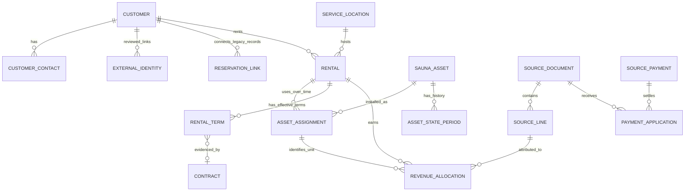

# Customer and sauna history: proposed domain model

Status: design for owner review, 2026-10-16. No schema, application code, credentials, infrastructure or production records changed for this design. This document supersedes the table-level assumptions in `proposals/xero-history/storage.sql`; that SQL must not be applied as the complete domain model. Final DDL waits for business-rule review and a read-only live schema/ledger comparison.

## The model in one sentence

A customer has rental relationships; a rental uses specific physical saunas for specific periods; agreement terms determine expected charges; accounting records establish billed amounts and cash receipts; reviewed allocations connect those amounts to rentals, saunas and service months.

This supports both customer lifetime history and each sauna's history without treating a customer, a booking, a physical sauna and an invoice as the same thing.

## Current repository evidence and its limits

| Evidence | Confirmed behavior / implication |
| --- | --- |
| `src/integrations/supabase/types.ts` → `sauna_inventory` | One physical inventory row with UUID, unit code, model, type, status, current/future customer references and a few dates. Reuse these UUIDs as durable asset identities. |
| `supabase/migrations/20260727165540_ec2ca8ef-d4cc-4ead-87d3-1b3f6fa431d4.sql` | Replaced the former customers table with reservation-based identity. Inventory customer FKs now point to reservations. Contains historical placeholder backfill logic; these rows need provenance review, not blind reuse as verified customer facts. |
| `supabase/functions/admin-api/index.ts` → `list_inventory`, `update_inventory` | Inventory displays current/future reservation identities and a current contract/CRM rate. Updates overwrite current fields; this is not a complete historical asset ledger. |
| Same function → `delete_inventory`, `delete_reservation` | Supports hard deletion; reservation deletion also removes events and clears assignments. A future history model needs restrictive references and retirement/archival actions before becoming authoritative. No deletion behavior changed here. |
| `src/integrations/supabase/types.ts` → `contracts` | Agreement snapshots, monthly rate, extras, signing and replacement/voiding metadata exist. Preserve signed documents; do not rewrite them to model later periods. |
| `supabase/migrations/20260710014359_1288c153-74dc-4ff3-a50c-9fb61c14a6da.sql` → `reservation_events` | Operational event log exists. Events and creation timestamps alone do not establish complete physical custody, earned revenue or historical utilization. |
| `supabase/functions/accounting-api/index.ts`, `src/components/admin/RevenueDashboard.tsx`, `AGENTS.md` | Existing projections use signed terms and CRM commitments. Preserve their rules and distinguish projections from historical actuals. |
| `supabase/functions/xero-admin/index.ts`, `_shared/xero.ts` | Read-only Xero access and first-page inspection exist. No full historical importer, reviewed identity directory or asset-level revenue allocation is active. |

These are repository facts plus the user's successful connection screenshot, not a live database audit. No evidence establishes that historical assignment or monthly payment data is complete. Existing current/future pointers must not be used to infer every prior rental. Xero contacts alone cannot tell us which physical sauna was installed; the owner-confirmed tracking tags provide the intended asset link, pending live coverage verification.

## Confirmed owner workflow: Xero tracking identifies saunas

The owner confirmed that Xero tracking options contain the same sauna numbers used in inventory. This is the preferred financial-to-asset link, replacing manual per-invoice asset selection when a reviewed tracking mapping is available. This is owner-provided information; live option IDs, label formats, historical coverage and uniqueness have not yet been inspected from Codex.

Keep the existing inventory identity and existing status vocabulary. Add dated history for those same statuses rather than requiring replacement status names or parallel operational state entry. The more detailed custody/serviceability dimensions below describe reporting distinctions; do not build them as a separate required workflow initially. A single status timeline is sufficient where statuses unambiguously express actual state. Record exceptional overlaps (such as maintenance while still installed) explicitly if needed, rather than infer them from accounting.

Add a small **reviewed tracking-to-asset mapping**: provider/tenant, tracking category ID, option ID, observed category/option labels, asset UUID, review state and validity/provenance. Namespace option IDs by tenant/category, never match any option from any category solely by label. Preserve stable IDs where returned; if a line only contains labels, retain the labels and resolve through the reviewed mapping, flagging collisions. Allow reviewed historical aliases mapping to the same asset. Renaming an option must not silently change the asset identity. Sauna-number reuse across distinct physical units requires dated resolution or an ambiguous flag; never assign old transactions to a new physical unit automatically.

For each source invoice/credit line, preserve all returned tracking entries and source line identity before resolving the selected sauna category. Matching order: approved source option ID mapping; otherwise propose an exact inventory unit-code match for owner confirmation. Preserve leading zeros and meaningful punctuation; do not guess that differently formatted codes identify the same unit. Missing category, unknown option, duplicate inventory code, conflicting mapping and unresolvable historical alias remain review exceptions. Customer match and asset match are independent approvals.

A reviewed tag identifies the asset associated with a billed line; it does not itself prove a service interval, installation date, payment allocation or revenue classification. A tagged deposit or sale remains a deposit or sale. Payment records follow their invoice/application links to the tagged lines. Mixed-unit invoices still need an explicit cash attribution rule where the payment does not identify which lines were settled. Missing tags on credits/refunds need explicit linkage/review rather than attribution to today's customer assignment.

Physical status history supplies known idle/maintenance/installed periods. Tracking supplies financial attribution. Missing invoice/payment activity alone is never evidence of idle time. Historical customer placements can be proposed from dated accounting evidence, but invoice issue dates and tag presence do not establish actual install/return boundaries.

The read-only inspection specification and Lovable handoff are in [xero-tracking-inspection.md](xero-tracking-inspection.md). Do not finalize schema or assert complete history until its findings are reviewed.

## Relationship overview

Names are conceptual; retain existing `reservations`, `contracts`, `sauna_inventory`, `sauna_types` and source integration storage wherever practical. New IDs are internal UUIDs; source IDs stay namespaced by provider, tenant and resource. No new database or accounting platform is proposed.

## Entity definitions and minimum fields

### Customer and identity

- **Customer:** `id`, `kind` (person/business), display name, lifecycle (active/archived), origin, created/updated times. Creation from Xero means a known customer profile, not proof of an installed rental or eligibility for an LTV denominator.
- **Customer contact:** customer ID, contact role, name, email, phone, validity dates and source. Multiple contacts per customer are allowed; no global unique-email constraint. Keep organization billing contact distinct from the contracting entity. A household can initially be one owner-reviewed customer with several contacts; do not infer households automatically or add a household hierarchy yet.
- **External identity:** provider, tenant, resource, external ID, customer ID, review state, source version, reviewer/session ID and decision timestamps. Unique provider/tenant/resource/external ID. Several Xero contacts can map to one customer after review. Maintain decision history and reopen stale decisions. Every match, including exact email, requires approval.
- **Legacy reservation link:** each reservation maps to at most one reviewed customer; a customer can have many reservations. Changing a link is audited; it never merges or deletes reservations. App-only identities remain visible.
- **Service location:** durable location ID, actual address where known, source and verification state. A rental references its service location; a relocation starts a new placement segment, preserving the old address snapshot. An account can rent at several locations simultaneously. Do not require an address just to create a historical Xero-only customer.

### Sauna assets

Use `sauna_inventory.id` for each physical sauna for its entire life, including model conversion, repair, moves and eventual sale. A marketed sauna type is a product category, not the physical asset identity.

Minimum asset fields: existing UUID and human unit code, current model/type, optional manufacturer serial, acquisition date/cost/currency when verified, in-service date, out-of-service date and disposition (sold/retired/lost). Unknown dates/costs stay null with provenance. Unit codes should be reviewed for uniqueness; a serial/model change does not create a new asset if it is the same physical sauna. Replacement with a different physical sauna does.

Record actual model/conversion changes as dated asset events with old/new values; historical reporting uses the classification effective then. Owner confirmed: track one identity per complete sauna initially. Component/heater-level tracking is deferred; it is not an initial prerequisite.

### Rentals, terms and physical assignments

- **Rental:** customer ID, optional originating reservation, service location, lifecycle, actual service start/end, billing anchor and verified acquisition reference when known. One relationship can span renewals and replacement units. Never infer actual installation from a scheduled appointment, a signed contract or a payment.
- **Rental term:** rental ID, effective start/end, base rent, add-ons, discount, currency, billing cadence, commitment end, optional contract ID and explicit administrative evidence. Signed contract rates take precedence over CRM fallback for the same effective period; CRM data never overrides verified signed terms. Rate changes add a term version. Store billing cadence and anchor separately from calendar reporting months. Minimum commitment is not the actual return date.
- **Asset assignment:** rental ID, physical asset ID, service-location snapshot, planned dates separately from actual installed/removed timestamps, confirmation state and source. A swap ends one assignment and begins another while preserving the rental. One rental may have several units; do not assume one customer or one invoice equals one sauna. For different per-unit rates, attach a term charge component to the applicable assignment; unspecified bundle rates remain rental-level until allocation is approved.
- **Asset state period:** asset ID, dimension, state, actual start/end, reason and evidence. Dimensions: custody/location (customer, warehouse, transit, unknown) and serviceability (serviceable, maintenance, damaged, unknown). Dimensions can overlap each other but periods in a dimension cannot conflict. A sauna may be physically at a customer and under maintenance. Commercial occupancy comes from confirmed assignments; a planned hold is a commitment, not installed utilization. Do not maintain a second independent customer-assignment history inside status periods.

Keep planned assignment/hold dates distinct from actual history. Retain the existing status UI as a compatibility view while the new periods are introduced. Operational availability is ultimately derived from custody, serviceability, commitments and booking rules, not from a single overloaded text status.

### Financial sources and allocation

- **Source document/line:** provider/tenant/source ID, document type and status, contact, issue date, currency, source modification timestamp, line descriptions, account codes, quantities, discounts, net/tax/gross and raw source reference. Preserve original Xero facts in private integration records. Invoice and credit lines must remain individually traceable; do not build a replacement general ledger.
- **Source payment/application:** source payment ID, cash date, currency and amount; applications connect payments to invoices. Preserve original application IDs and reversals. A payment can settle several charges and a charge can be settled by several payments. Credits, refunds, overpayments and prepayments need distinct treatment; a credit is not automatically a cash refund.
- **Revenue allocation:** source line, reviewed customer/rental, optional assignment, charge category, service start/end, allocated net/tax/gross, currency, method, confidence/review state and version. Categories include rental, delivery, sale, add-ons, refundable deposit, tax and unknown. A line can span multiple assets or months; allocations must conserve the source amount. Unknown asset or service period stays explicitly unallocated. Do not assign all historical payments to the sauna a customer has today.
- **Cash attribution:** derive from reviewed payment applications plus approved invoice-line allocations. If an invoice covers multiple saunas and no explicit line-level payment designation exists, offer an owner-approved proportional rule, label it allocated, and preserve rounding residuals deterministically. No silent equal splits. Payment totals attributed to all assets plus unallocated cash must reconcile to actual cash, net of separately represented refunds. Refundable deposits remain excluded from revenue, even when cash is received.
- **Costs/acquisition (later):** classify real expense lines by acquisition channel/date and customer or campaign where supported; optionally allocate maintenance/delivery/asset costs. Keep purchase capital cost distinct from operating costs. CAC, contribution and asset payback wait until the required definitions and coverage are verified.

## Time, correctness and history rules

Use `America/Los_Angeles` for business-day/calendar-month grouping, UTC for actual instants and SQL dates for dates without a known time. Model all intervals as half-open `[start, end)` so a swap at a boundary does not double-count time. Open ends are allowed only for current periods. Never substitute record creation time for an unknown actual date. Date-only historical boundaries retain their precision rather than invented timestamps; day-level reporting can use them, sub-day precision cannot.

A physical sauna cannot have overlapping confirmed actual assignments. A customer's multiple simultaneous rentals are valid. Enforce assignment conflicts in database transactions with asset-row locking and an exclusion/range constraint appropriate to the chosen date/time representation; not only browser validation. Holds/plans require separate conflict rules. Assignment/term/location changes must validate ordering, known dates, tenant/source ownership and parent existence.

Capture both effective time (when a fact was true) and recorded time (when we learned it), plus evidence, verification state and supersession history. Initially use relational rows and a small append-only change audit; a generalized event-sourcing platform is unnecessary. Backdated corrections invalidate affected monthly aggregates and expose a revised/as-of timestamp. History is corrected through audited supersession, never silent overwrites or hard deletes. Customer merges preserve prior IDs/aliases and all source links, with explicit review and an undo strategy.

## What the sauna dashboard can answer

Each sauna gets a timeline of actual assignments showing customer, location, start/end, rental/contract references and missing data warnings, alongside custody/serviceability periods. A separate planned lane shows reservations and expected returns. No fictional rental examples are seeded.

Monthly columns should distinguish:

| Measure | Meaning / prerequisite |
| --- | --- |
| Contracted rent | Effective agreed charge for the billing/service period; not proof of invoicing or payment |
| Billed rental | Reviewed Xero rental lines; show invoice month separately from service month |
| Earned rental | Approved allocation to service months, with the agreed proration rule |
| Cash received in month | Actual payment/refund dates with approved asset attribution; can relate to earlier or later service |
| Paid toward service month | Applications received as of the report date for that month's charges, even if paid late; clearly separate from cash-date totals |
| Outstanding | Actual billed receivable less valid payments/credits as of the selected date; not contracted rent minus cash |
| Assigned/occupied days | Confirmed actual assignment intervals intersected with the month |
| Known idle days | Known in-service time with no assignment and evidence of availability/custody; missing history is unknown, not idle |
| Unavailable days | Known maintenance, repair or transit time, reported by cause with defined non-overlapping utilization buckets |
| Unknown days | History gaps; shown prominently and excluded from claims of complete utilization |

First show a daily/monthly breakdown of occupied-serviceable, occupied-unserviceable, unassigned-serviceable, unassigned-unserviceable/transit and unknown time. Maintenance at a customer remains occupied-unserviceable, preventing double-counting a day as both idle and occupied. Pre-acquisition, not-yet-in-service and post-disposition periods are outside active fleet denominators. A sale ends rental fleet utilization at the confirmed disposition time; record sale proceeds separately from rental revenue.

Report two explicit metrics: **occupancy** = confirmed occupied days / active fleet days; **serviceable utilization** = occupied-serviceable days / known serviceable days. For incomplete history, show coverage and partial known-period figures rather than an unqualified lifetime percentage. Empty denominators mean unavailable, never 0%. Reservation holds are not occupied days. Do not label all non-occupied time demand-related idle time or estimate lost revenue from a current rate.

For partial months, agreed billing-cycle terms govern charges; calendar-month earned revenue needs an approved service-period/proration policy. Daily allocation is a proposal, not an accounting assertion. Rent suspension, free periods, mid-month swaps and bundled units require explicit handling. Sum of asset allocations + unallocated amounts must equal rental/source totals. A price change today cannot recalculate prior months using today's rate.

## Customer metrics on the same model

A customer page joins reviewed identities, all reservations, actual rentals/assignments and source financial allocations. This handles return-and-rerent without duplicating the customer. Installed-rental LTV counts a customer once at their earliest verified actual installation; Xero-only sales customers are a separate segment until the owner chooses a broader definition. Preserve both acquisition cohort and calendar-month trends. Unknown historical first installations cannot be assigned today's date or the first imported invoice date.

Keep billed revenue, realized/earned revenue, collected cash, contribution and predictions separate. CAC requires verified acquisition spending and first-customer attribution; contribution requires verified variable costs. Current signed/CRM committed-revenue projections remain unchanged until a separately reviewed replacement preserves their rules. Historical reporting must not convert planned renewals, holds or unsold inventory into actual revenue.

### Customer table LTV (owner-approved rental-only scope)

The customer table displays recorded committed LTV as the sum of each non-superseded rental term's minimum months multiplied by base monthly rent plus monthly add-ons. Purchase bookings, canceled rentals, and voided agreements are excluded. Signature-unconfirmed historical terms are labeled for review. Missing terms and unquantified early-exit waivers/settlements display Unknown; do not invent a proration or treat the original contract minimum as still collectible after a waiver. This metric is the recorded minimum, not an outstanding balance or speculative renewal forecast.

Actual LTV is classified rental/add-on cash receipts less classified rental/add-on outgoing payments, from the latest imported Xero history. Exclude voided allocations, owner-reviewed duplicate receipts, deposits, taxes, sales, delivery, and unclassified cash. No usable classified history means Unknown, not zero. Figures are in USD; unsupported rental currencies remain Unknown. Historical/source payments are never modified by these display calculations.

Current sauna details and Stripe/Xero contact links are in the customer Overview rather than table columns. Both LTV columns support numeric sorting, search, and column filtering; unknown values sort last in either direction.

## Review workflow and exceptions

1. Review identities for all Xero and app customers: approve link, choose another customer, explicitly create profile, exclude or defer. Flag Xero contacts without app matches and app records without Xero links. Supplier-only contacts require customer classification before creation. Profiles require only real known fields, no fake reservations.
2. Review asset history separately: identify physical unit, actual placement boundaries, swaps, returns, maintenance and historical gaps. Same customer/name alone is insufficient evidence for an asset assignment.
3. Review financial allocations: category, rental, asset(s) and service period. Automatically proposed matches are pending; neither exact customer match nor invoice payment status approves asset allocation.
4. Reconcile source counts/completeness and monthly currency totals against Xero; then approve derived reports. Report all unresolved and unallocated amounts, not just clean records.

Concurrency checks, idempotency keys, unique provider/tenant IDs and row-version conflict detection prevent double creation or conflicting decisions. Several Xero contacts may link to one customer; one source identity may not link to several customers without an explicit more complex allocation model. Every approval records old/new decision and source version. Shared-password auth establishes an admin session, not a verified named employee; do not claim individual accountability until staff auth exists.

## Gradual implementation without a rewrite

1. **Design review now:** agree entities, vocabulary, business rules and open decisions below. Compare live schema/ledgers read-only, inventory evidence sources and migration ownership. Do not apply the earlier proposed SQL.
2. **Identity foundation:** add customer profiles/contact/source links and reviewed reservation links. Keep current reservation/inventory behavior and APIs intact. Allow explicit Xero-only customer creation only after an approved endpoint/UI and migration exist.
3. **Asset/rental foundation:** keep inventory UUIDs; introduce rentals, actual assignments and period history. Backfill only verified current facts as of a documented coverage boundary; leave the prior period unknown. Add missing historical facts through review, not inference. Later make operational changes write periods transactionally with a compatibility view for existing screens. Never run competing old/new assignment writers.
4. **Private accounting ingestion:** use existing Xero OAuth and checkpointed imports with pagination/retry/tenant isolation. Stage source facts; source records are not approved identity, rental or asset allocations. Classify and review mappings before financial display.
5. **Verified reporting:** customer and sauna timelines first, then billed/paid monthly tables, then approved earned-revenue/utilization metrics with coverage. Add costs/CAC and optional asset payback after their inputs exist.
6. **Operational cutover, separately approved:** move current/future field editing behind one authoritative transactional service, preserve availability/hold logic and projections, retire destructive deletions, and reconcile old/new reads before switching. Retain compatibility until Lovable screens use the new API. No dual authority for current assignment.

Use the same repo, PostgreSQL backend, Edge Functions, Cloudflare hosting and Lovable visual workflow. Sensitive financial/PII reads stay password-verified server-side with private RLS/grants. No production data in preview bundles, test fixtures or public endpoints. Test schema/constraints on an isolated database using test-only inputs; no automatic production import/deploy. Each schema or activation step is separately reviewable and requires approval.

## Scenarios the final design must pass

- Customer rents, returns, and rents again: one customer, distinct rental periods, no retention reset from renewals.
- Customer has two saunas at different properties: independent assignments and reviewed per-unit billing allocation.
- Same rental swaps units mid-cycle: no assignment overlap; prior revenue stays with correct unit/service period, cash attribution remains explicit.
- Rate changes, discounted/free month or suspension: terms retain effective dates; no historical rewrite.
- Late payment or prepayment: cash-month and service-month views differ without double counting.
- Partial refund, credit, deposit or sales invoice: correct category and amount conservation; no deposits counted as earned revenue.
- Idle then maintenance then installation: distinct known downtime causes; gaps remain unknown.
- Maintenance at customer's property: occupied but unserviceable, not simultaneously idle.
- Unknown return date or asset identification: unresolved flag; no invented interval or unit assignment.
- Unit converted, sold or retired: same asset identity and dated classification/disposition history; sold unit exits fleet denominator.
- Repeat imports, backdated correction or concurrent reviews: no duplicate customers/payments; affected reports marked revised/unreconciled.

## Owner decisions before final schema

Confirmed scope: one identity per complete sauna initially. Remaining recommended defaults need owner review:

1. Complete-sauna identity is confirmed; defer heater/component assignments.
2. Allow customers to be people or businesses, multiple contacts, several rental locations and concurrent units; no automatic household merging.
3. Use confirmed installed-to-removed periods for occupancy; split maintenance/transit and unknown time visibly.
4. Retain existing billing terms and anchor dates. Agree service-month proration and cash attribution rules before earned-revenue charts.
5. Preserve current installed-rental LTV definition; report sauna sales separately. Decide whether later overall customer LTV includes both.
6. Identify evidence for historical asset/customer placements: installation/collection records, prior spreadsheets or dated notes. Owner-reviewed facts may be entered with evidence; absent facts remain unknown.
7. Decide whether historical reporting needs day-level boundaries or exact timestamps. Default day-level historical reporting, precise instants only when actually known.

No decision in this document supplies missing history, authorizes applying SQL or changes production configuration.
