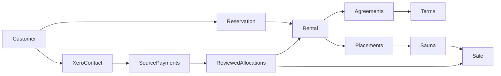

# Customer and sauna history

A customer is an identity. A reservation records a booking, including a manual booking made before this website existed. A rental is a continuous service relationship arising from that reservation. Renewals and unit swaps stay on the same rental; a later return to renting starts another reservation and rental.

Original signed contracts and PDFs are preserved. A separate dated term records minimum commitment, agreed base rent, extras, currency, type, and source. Original extracted values and owner corrections remain separate. An unknown effective date is not replaced with the import day. Signed-only agreements can have planned terms; a first actual install activates one unambiguous planned term. Multiple agreements require review before dating their rate periods.

Historical bookings are tagged manual/historical. They need a selected customer, but an unknown booking date, email, or planned installation can remain absent. They cannot enter customer-facing token, payment-setup, upload, or reservation-update routes. Manual booking creation creates no holds, notification intents, or provider calls.

For the reviewed historical backfill, the owner authorized the first positive, authorized Xero Receive Money transaction with a positive Subscription Revenue line as an installation-date proxy. The source transaction ID, snapshot time, and rule are retained. An explicitly confirmed actual install date takes precedence. This customer-level proxy is not proof that a particular physical sauna was installed that day, or that a later separate rental began that day. Unknown physical placement periods remain explicit gaps. Old-folder rentals without a current unit are owner-confirmed ended. Their removal is an estimated window from the last qualifying receipt through one calendar month later, bounded by the ended-as-of date. The exact actual end date remains absent until confirmed, and the source receipt is retained. Current assignments stay active.

A physical placement records the sauna, type at installation, address, actual install/return dates, and evidence. The database rejects overlapping placements for a sauna. Swaps close the old placement, open the new one and update inventory atomically, without restarting the original commitment. Inventory retains its existing columns and table layout; current assignment and install changes use these operations. Existing unconfirmed links remain visible until their placement dates are reviewed.

Install, return, swap, sale, retirement, settlement, cancellation, term, and historical correction actions use one transactional database command. Each request has a stable UUID for safe retries; stale rental versions are rejected. Failed operations roll back all writes. Closed rentals cannot be installed again; signed pre-install cancellations need a settlement or waiver. Settlement reasons and prior replaced decisions remain in history. Sales keep their own price and customer; a sale price is not cash received.

Xero cash remains an imported source record. A reviewed allocation references its original tenant and transaction, verifies the customer mapping, and can split its amount among rental rent, add-ons, delivery, deposit, tax, sale, or other. Allocations cannot exceed source cash. Outgoing payments retain their direction; they are not automatically called refunds. A correction voids an allocation with a reason, preserving the original record. Classification does not change Xero or charge anyone.

The new tables have row security and no public/anonymous/authenticated access. Only the existing password-verified admin API reads them. Service-role direct writes are revoked; operations use the restricted command. PDFs stay in the existing private signed-contracts bucket; admin access uses short-lived URLs. Local preview uses an isolated PostgreSQL copy and loopback-only file routes; private records and documents are never part of the production bundle.

This foundation does not introduce LTV dashboards or replace the existing signed-contract/CRM commitment projection. Missing dates, physical unit history, signature evidence, and rental breaks remain reviewable gaps rather than assumed facts.

## Verification

`npm test`, `npm run typecheck`, production and preview builds, and the existing preview-isolation browser suite cover the frontend. `python3 scripts/test-rental-lifecycle-database.py` creates a uniquely named test database on **127.0.0.1**, port 55439 (override with `SF_LIFECYCLE_TEST_PG_PORT`), using `psql` (override with `SF_LIFECYCLE_TEST_PSQL`). It requires a disposable local PostgreSQL instance and a role allowed to create databases/roles. It never accepts a remote host. Tests include a real two-client installation race, transaction rollback, commitment preservation through swaps, historical date bounds, cash caps/ownership/corrections, private access, and normal website signing/voiding compatibility.
