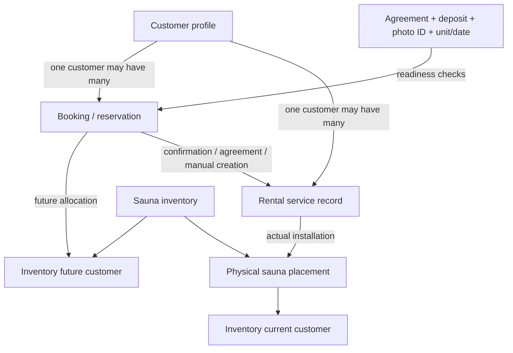
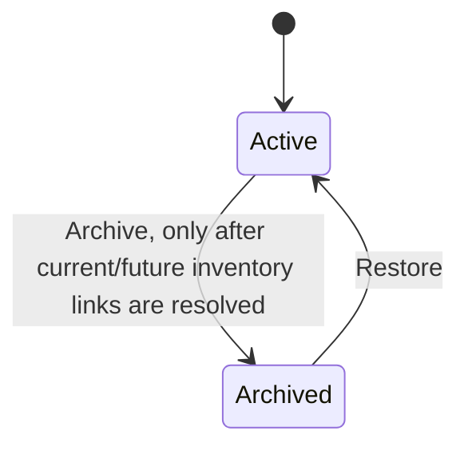
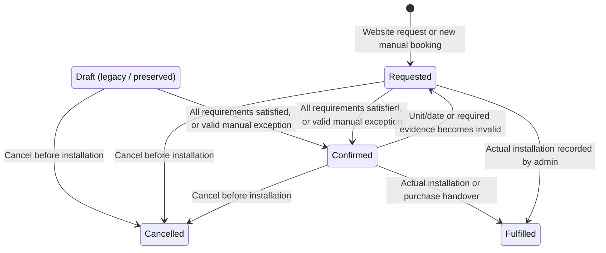
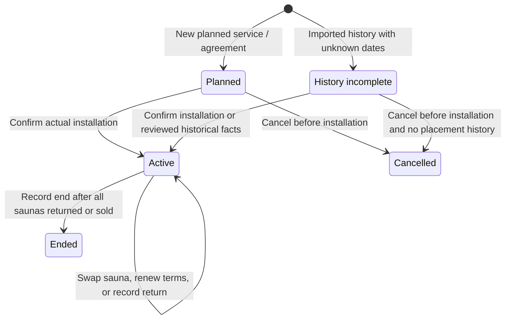
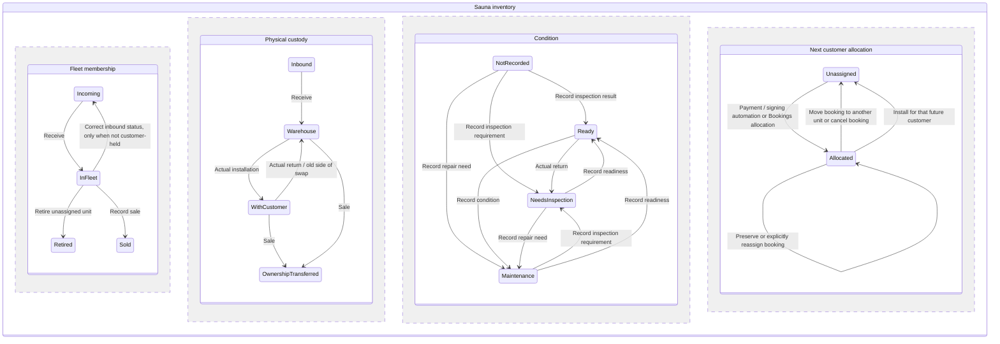

# Booking, customer, rental and inventory state machines

These are separate records and state machines. A numbered-unit allocation is a promise about a future sauna; it is not a physical installation. Inventory associations are authoritative, and the reservation's sauna pointer follows them. The diagrams summarize the operational paths, not every historical correction.

## How the records connect

Customer identity, booking acceptance, service dates, physical placement, money received and signed commercial terms are not interchangeable.

## Customer profile

A profile is not a prospect/paying/returned status. One profile can have multiple bookings and rental periods. Archiving preserves history; it does not cancel bookings, return equipment or remove accounting records.

## Booking / reservation

Automatic rental confirmation requires a signed agreement, received deposit, uploaded ID, matching numbered sauna and compatible installation date. A manual exception may waive evidence, with a note, but still requires a valid numbered unit/date. Purchases require manual acceptance; accepting a purchase without a handover date leaves it Requested. Legacy confirmations may be preserved with visible missing-requirement warnings. Historical manual bookings are handled through rental history.

A paid deposit may allocate a **future customer** immediately while the booking remains Requested. There is no independent `Held` booking state: `Reservation Hold` is a legacy label, while the actual allocation is an inventory association. The five-day hold deadline is informational in the current payment handler, not an automatic release transition.

Canceling a signed booking may require a recorded settlement. Fulfilled and cancelled bookings are retained; started rentals must use the rental lifecycle rather than pre-install cancellation.

## Rental service

Returning equipment does not automatically end rental service. A swap keeps the rental and original commitment dates, closes the old placement, and opens the replacement placement. A sale records ownership transfer separately and may end service when no installed units remain. Historical corrections preserve unknown dates instead of inventing them.

## Inventory: independent dimensions

These dimensions coexist. For example, a sauna may be **Incoming + Inbound + Ready + allocated to a future customer**, making it unavailable for another booking.

Fleet and custody labels are derived from the inventory status, retirement field and customer links; condition is stored separately. Retired and sold equipment cannot be made bookable through a condition edit. A returned unit requires readiness confirmation before redeployment; pickup and the next installation may share a date.

## Planned return / booking availability

```mermaid
stateDiagram-v2
  state "With current customer; no return plan" as Held
  state "With current customer; pickup and next availability planned" as Planned
  state "Actual return recorded; inspect / confirm readiness" as Returned
  Held --> Planned: Schedule pickup and availability
  Planned --> Planned: Reschedule with conflict and version checks
  Planned --> Held: Cancel plan, only after booking conflicts resolved
  Held --> Returned: Record actual pickup
  Planned --> Returned: Record actual pickup; clear plan
```

Planning preserves the current customer, placement, rental dates and commitments. Next availability may equal the planned pickup date. Passing the planned date never records an actual pickup automatically; overdue plans require review.

Availability is derived rather than a separate manually set status:

| Situation | Availability |
| --- | --- |
| Sold, retired, reserved for a future customer, or not Ready | Unavailable |
| Current customer, no valid pickup/availability plan | Unavailable |
| Current customer, Ready, valid non-overdue plan, no future allocation | Available on the planned date; not available now |
| Incoming, Ready, no future allocation, booking date after inbound arrival | Available on the booking date |
| Ready and unreserved in warehouse | Available now |

## Current allocation mismatch to be aware of

The deployed `assignSoonestSauna` helper preserves existing assignments, matches style/model/location and chooses the earliest eligible availability date. Its candidate filter excludes Maintenance/inspection but permits an unknown condition. For incoming candidates it requires a stored availability date, but does not require that date to follow inbound arrival or fit the requested installation date. The stricter public-availability and booking-readiness checks can therefore flag an automatically allocated unit as unavailable or requiring date review. This document describes that existing behavior; it does not silently change the allocator policy.

The inventory customer cells are read-only. Direct customer-link edits are also rejected by the admin API. Bookings supports reassignment and cancellation; it currently has no standalone release-unit-without-cancelling operation. Current placements must use actual return/swap/sale actions in Rentals.

## Sources

- [Booking and inventory labels](../src/lib/bookingModel.ts)
- [Booking reconciliation](../supabase/migrations/20261018040000_booking_lifecycle.sql)
- [Current booking command and inbound checks](../supabase/migrations/20261018170000_separate_inbound_and_booking_availability.sql)
- [Authoritative assignments and purchase acceptance](../supabase/migrations/20261018080000_authoritative_assignments_and_booking_links.sql)
- [Rental lifecycle](../supabase/migrations/20261017220000_rental_lifecycle.sql)
- [Customer profile archive constraints](../supabase/migrations/20261017075300_core_customer_rental_foundation.sql)
- [Automatic allocation](../supabase/functions/_shared/assignSauna.ts)
- [Payment handler](../supabase/functions/stripe-webhook/index.ts)
- [Derived availability](../src/lib/inventoryAvailability.ts)
- [Planned returns](../supabase/migrations/20261028103314_schedule_sauna_returns.sql)
