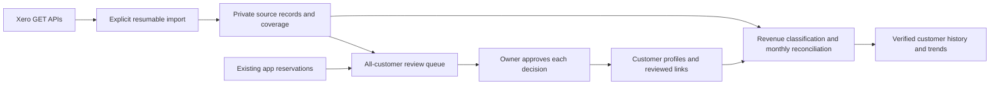

# Historical import and customer reconciliation — prepared, not activated

No production reads/imports, schema changes, customer creation or backend deployments were performed for this proposal. Pure matching/import cores are executable and tested; storage SQL is review-only. The production UI only shows the empty review explanation. There is no working approval/import endpoint yet. Existing Xero OAuth remains unchanged.

## What the current repository confirms

Lovable deployed `supabase/functions/xero-admin` and `xero-callback`, with integration storage recorded in `drizzle/migrations/0007_provision_private_xero_oauth_storage.sql`. The user's browser shows SF Sauna authorized and successful first-page inspections. This is evidence of read access, not complete history, token-refresh reliability or reconciled totals. The active `_shared/xero.ts` is the current granular scope authority; do not restore the earlier broad scopes from old documentation.

Operational customer identities are currently `reservations`: inventory customer references point there, and reservations require booking-specific fields. Historical migrations created and then replaced a `customers` table. Never recreate that obsolete table or create placeholder reservations for accounting contacts. Verify the live catalog, triggers and migration ledgers through Lovable before choosing a migration filename; this proposal is intentionally outside both migration directories.

## Data flow

## Smallest implementation

1. Add the private tables in `storage.sql` after review. Use the existing PostgreSQL backend, service role, admin password and repository. No new database or hosting.
2. Implement an explicitly started, resumable import action in password-verified `xero-admin`. Use the existing token/refresh helper and fixed GET routes only. Snapshot the selected tenant when creating a run; switching tenant must not redirect an in-progress run. Import Contacts, Invoices, CreditNotes and Payments into private integration tables. No Xero writes. No operational record updates.
3. Read existing app reservation identities server-side and prepare customer-profile candidates. Do not automatically merge reservations with equal emails: show individual records until the owner confirms they belong to one profile. New Xero-only customers become customer profiles; no booking, installation, contract, payment status, email, webhook or inventory side effect.
4. Expose the review queue and approve actions through the existing password gate. Only then wire the empty `CustomerMatchReview` component to real records. No seeded/demo rows or invented counts.
5. Classify revenue and reconcile month/currency totals before enabling customer history or metric charts. Keep missing/incomplete metrics at Waiting for data.

## Import contract and completeness

`pagination.ts` is an injected-adapter core, not a production client. Implement `read` with an explicit supported page size and resource-appropriate query parameters, validate the payload collection (missing is an error), fixed host/path, GET only, timeouts, no redirect following and the run's authorized tenant. Respect 429 Retry-After; retain the last committed checkpoint and resume later. Never retry accounting writes (none exist). Stop on expired consent, 401/403, malformed response or DB failure. Use a per-run lease to reject overlapping workers, a bounded page/time budget and a repeated-page fingerprint guard. These production transport/lease adapters are still to implement.

Read until a valid empty terminal page, not merely five records or a short page. Adapter `commit` must atomically upsert records by tenant/resource/source ID and advance the checkpoint in one DB transaction. Hash canonical source content as source_version if provider timestamps are absent. Resume/replay must not duplicate records or approvals. Preserve original source fields privately; no raw customer payloads in logs, frontend assets or Git. Source changes reopen affected identity reviews with a new revision, retaining previous decisions in audit history; financial changes invalidate reconciliation. A source contact disappearing from a later run is flagged, never silently deleted.

Coverage per run/resource must include: requested filter/date range (initially all available history), first/last successful read timestamps, pages read, terminal-page reached, distinct source count, observed earliest/latest transaction dates, missing dates, unresolved contact references and errors. Date range observations do not prove complete coverage. Xero pagination is not an immutable snapshot: overlapping incremental reads and final reconciliation are required if records change mid-run. A run is source_complete only when every resource finishes; reconciled is a separate state. Persist failures, never convert them into zero records.

## Review every identity

Queue filters: All, Pending, Suggested matches, Ambiguous, Xero-only, Classify contact, App-only, Approved, Excluded and Deferred. All includes already approved decisions for ongoing review. Display real Xero name/email/phone and customer/supplier flags beside app name/email/phone and reservation references; show reasons rather than a fabricated confidence percentage. Search the entire app directory, not just suggestions. Treat incomplete app coverage as unknown, not Xero-only. Flag app identities without Xero links separately; do not create Xero contacts.

`reconciliation.ts` proposes candidates using exact case-insensitive email, full phone digits retaining country codes, and normalized exact name. Names alone require verification; no fuzzy auto-match, email alias stripping, household inference or automatic approval. Multiple candidates always stay ambiguous. Shared email/phone can identify several different people. Every contact starts pending, including exact matches.

Actions on each row:
- Link to an existing app customer, or explicitly group selected reservation identities into a reviewed profile first.
- Create customer from this Xero contact after reviewing editable name/email/phone. Flag missing information; do not invent email, address, installation or acquisition date. One transaction creates the profile and its approved link. Supplier-only/other contacts need explicit customer classification before creation.
- Exclude with a reason (supplier, duplicate, non-customer, etc.), or defer with a reason.
- Reopen an approved decision, then relink if needed. Never delete transaction history or merge source transactions implicitly.

For every action the server must check admin authorization, selected/authorized tenant, contact existence and current source hash, target customer existence and current review revision. Use a DB transaction with row lock and compare-and-swap revision; losing concurrent requests return 409. Unique tenant/contact decision prevents duplicate creation on double-click/retry. Persist an audit event with old/new decision and revision in the same transaction. Shared-password auth can record only an admin-session/request identifier, not verified staff identity; never store the password. Reopening also invalidates affected aggregates. Do not expose service role or direct browser writes. `validateReview` covers preconditions; the transactional endpoint and RPC are deliberately not deployed/implemented here.

## Reconciliation before metrics

Only customer sales invoices (ACCREC) and relevant sales credit notes qualify for revenue classification; supplier invoices and payments are not customer revenue. Separate rental, delivery, sales, deposits, taxes, discounts and unknown line items. Keep unknown items excluded from metrics with visible unresolved totals. Preserve currency; never sum currencies or assume an FX rate. Use decimal/numeric arithmetic, not binary floating point. Avoid double-counting credit allocations and cash refunds; investigate overpayments/prepayments and bank-transaction-only income before claiming complete collections. The four resources may not contain all cash activity; do not broaden scopes silently.

Invoices establish billing, not automatically earned rental revenue. Show billed revenue by invoice month if reconciled; earned revenue/LTV needs service-period allocation, credit treatment and confirmed customer eligibility. Payments are cash allocations, not additional revenue. Require a month/currency control sheet comparing source invoice net/tax/gross, credits and payment totals against the owner's Xero export/report for the same basis, dates and status filters. Store reviewer, source report date and differences; no reports scope is currently required if the owner supplies the comparison. Show unreconciled amounts and unmatched counts; never use them as approved metrics.

Customer profiles created from Xero do not imply installation or a first-acquisition date. Realized LTV eligibility follows the agreed installed-customer definition; historical installation dates need separate evidence. CAC requires classified acquisition spend plus verified new-customer attribution/dates; contribution needs costs. Until those exist, keep Waiting for data. Later trends should support calendar month and acquisition cohorts with an explicit as-of date, data coverage and reconciliation state.

## Activation gates and acceptance

Before any import: approve reviewed SQL/migration, private table access tests, production transport/transaction adapters and backend deployment. Before customer creation: approve reviewed decision UI and transactional creation endpoint. Current main publication does neither.

Checks required at activation: unauthorized and cross-tenant requests denied; anon/authenticated SQL access denied; failed/429 page resumes correctly; duplicate run/page does not duplicate records; token rotation succeeds; page exhaustion checked; changing source invalidates review; all exact matches remain pending; ambiguous and supplier contacts flagged; app-only identities visible; two concurrent create requests yield one profile; stale revision returns 409; exclusion/defer requires reason; several contacts may link to one reviewed customer; no booking/email/inventory effects; reconciliation discrepancy blocks metrics.

Current local tests exercise only pure matching/precondition/import logic. They use isolated test-only synthetic identifiers, never runtime data. SQL and real API pagination have not been executed. The current first-page inspection is not a historical import.
